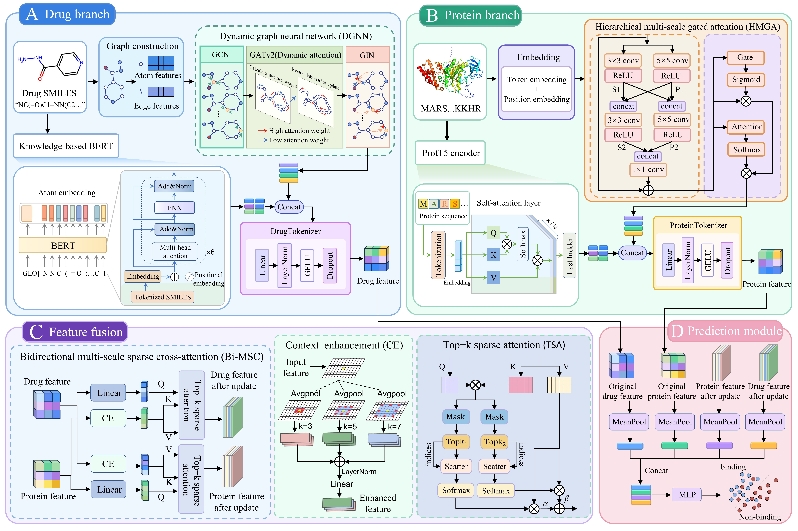

# MSF-DTI

This repository contains the implementation of **MSF-DTI: A Multimodal Sparse Fusion Framework Integrating Pre-trained Language Models and Dynamic Graph Networks for Drug-Target Interaction Prediction**.

Please see our manuscript for more details.

## 1 Requirements

Before running the code, create and activate a Python environment:

```python
conda create -n MSF-DTI python=3.7
conda activate MSF-DTI
```

Install the required dependencies according to your environment and the packages used in the source code:

```python
cd MSF-DTI
pip install -r requirements.txt --no-cache-dir
```

## 2 Project Structure

- **`bert/`**: Stores files related to the KB-BERT drug pre-trained language model. 
- **`datasets/`**: Stores the datasets required for drug–target interaction prediction, primarily including three publicly available datasets: `BioSNAP`, `DrugBank`, and `BindingDB`. Each dataset typically contains the SMILES representations of drug molecules (`smiles`), protein amino acid sequences (`protein`), and interaction labels (`labels`, with values of 0 or 1).
- **`demo/`**: Stores usage examples of the model, including sample data, ProtT5 and KB-BERT feature extraction examples, model prediction examples, and the prediction results file `predict.csv`.
- **`Result/`**: Stores the trained model weights.

In addition, the main scripts and files are as follows:
- **`readData.py`**: Raw Data Preprocessing Module, responsible for converting raw SMILES representations and protein sequences into features required by the model.
- **`MCPdataset.py`**: Dataset Construction and Batch Processing Module.
- **`requirements.txt`**: Lists all dependencies and their versions for quick environment setup.
- **`Mymodel.py`**: Overall Architecture of MSF-DTI, comprising the drug feature extraction module (`smiles_model.py`), the protein feature extraction module (`protein_model.py`), and other core components.
- **`train.py`**: Trains the MSF-DTI model and generates the checkpoint required for subsequent predictions.
- **`predict.py`**: Evaluates model performance on the test set.

## 3 Quick Start
Run the following commands to train and evaluate the MSF-DTI model.

```python
python train.py 
python predict.py
```
You can also refer to **`demo/predict.ipynb `** for usage examples.


